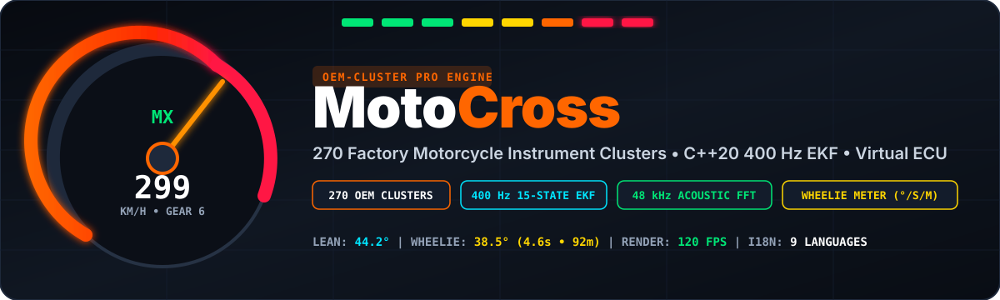
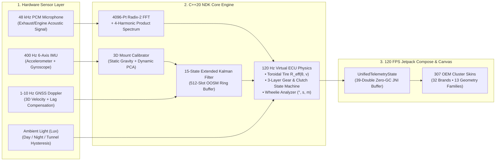

<div align="center">



# 🏍️ MotoCross (`OEM-Cluster Pro`)
### 100% Authentic Motorcycle Instrument Cluster Simulator (307 Models), 400 Hz C++20 NDK Sensor Fusion, Virtual ECU Telemetry Engine & Wheelie Analyzer

[](https://github.com/umitsTASCI/MotoCross/actions)
[](https://github.com/umitsTASCI/MotoCross/releases/latest)
[-3DDC84?style=for-the-badge&logo=android&logoColor=white)](#)
[](#)
[](#)
[](#)
[](#)

</div>

---

## 🆕 v5.0.0 — What's Changed in This Release

- **307 OEM clusters across 32 brands** (was 270 / 23): new Voge, Kove, Norton, Bimota, Brixton, Jawa, Beta, GasGas, Fantic and Sherco families, plus the missing Hero Mavrick 440 / Karizma XMR 210, CFMoto 450MT / 675NK / 800MT, BMW K 1300 R, Kawasaki ZX-12R, Aprilia RSV Mille RP and Suzuki TL1000R / Intruder M1800R clusters.
- **KTM 390 Duke Gen 3 (5" bonded TFT) redrawn 1:1** against the factory dash: large gear indicator top-left with clock and coolant temperature beside it, the thin diagonal tach sweep with white fill and red 10 000 zone, the ride-mode square top-right, and the five-cell `KTM LAUNCH · ABS · MTC · TIMER · DTC` row with hairline separators.
- **Analog needle calibration fixed for every hybrid dial:** needle and redline ratios now divide by the *last labeled tick* instead of the raw catalog maximum, so a 300 km/h dial labeled to 320 no longer overshoots by ~7 % and a 12 500 rpm tach no longer drifts against its own numbers.
- **Cluster layouts are no longer hash-random:** dual-analog dashes are limited to the models that actually have two dials (FJR1300, F4 750 Oro, ZX-12R, TL1000R, K 1300 R, RSV Mille); every sportbike in the family renders the real single-tach + LCD layout (BMW S1000RR K46 included).
- **Simulation mode now shares the native needle physics:** the same ωn = 42 / ζ = 0.88 spring-damper, the same ±150 rpm @ 14 Hz rev-limiter and the same idle-relative shift-light thresholds as the C++ engine — no more divergence between "real" and "simulated" readings.
- **Settings completed:** 12/24-hour clock, L/100 km · km/L · MPG fuel units, explicit screen-orientation mapping (auto / fixed landscape / fixed portrait) and a **persistent odometer card** with ODO write, trip A/B reset, drag-peak reset and a double-confirmed ODO reset.

---

## 🎯 Vision & Core Engineering Philosophy

**MotoCross (`OEM-Cluster Pro`)** is **not** a basic windshield HUD projection app. It is a pixel-perfect **Real Motorcycle Instrument Cluster & Virtual ECU Telemetry Engine** that transforms any handlebar-mounted Android smartphone or tablet into the factory original instrument cluster of **307 iconic motorcycle models** (*OEM TFT displays, Negative Black LCDs, Positive Transflective LCDs, and Analog-Digital Hybrid Tachometers*), powered by a **400 Hz C++20 NDK Strapdown Inertial Navigation Engine** and **48 kHz Acoustic DSP**.

> [!IMPORTANT]
> ### 🏆 THE GOLDEN RULE: Strict Separation of Mechanical Bike Profile vs. Visual Gauge Skin
> 1. **My Garage (`BikeMechanicalProfile`) = Single Source of Truth:** The motorcycle mechanical specifications configured in **My Garage** (*front/rear sprockets, 1st–6th gear ratios, primary reduction, tire dimensions, idle RPM, redline/rev-limiter RPM, and torque/power curves*) serve as the sole physical source of truth.
> 2. **307 Instrument Clusters = Pure Visual UI Skins (`DeclarativeGaugeSpec`):** Any dashboard selected from the **307-model catalog** (*e.g., BMW S1000RR, Yamaha YZF-R1, KTM 390 Duke, Ducati Panigale V4, Suzuki Hayabusa*) functions strictly as a high-precision visual UI skin.
> 3. **Real-World Scenario:** If you configure your own motorcycle as a **KTM 390 Duke** (or Yamaha MT-07, Honda CBR250R) in *My Garage* and select the **BMW S1000RR** or **Yamaha YZF-R6** instrument cluster on screen, the S1000RR dashboard displays **your motorcycle's true speed, true gear, and true RPM**, and triggers the S1000RR Shift-Light flasher at **your motorcycle's optimal shift RPM**!

---

## 📲 How to Install the App (Step-by-Step APK Installation Guide)

You can install **MotoCross** on your Android smartphone or tablet using any of the **4 methods** below:

### 🚀 Method 1: Direct APK Download & Sideload on Your Phone *(Easiest — No PC Required)*

Pre-built, ready-to-install `.apk` packages are published directly in this repository's **Releases** section:

1. **Download the APK from GitHub Releases:**
   * Open **[Releases](https://github.com/umitsTASCI/MotoCross/releases/latest)** on your Android phone (or click the orange **`DOWNLOAD APK`** badge at the top of this page).
   * Under **Assets**, tap **`MotoCross-v1.0.0.apk`** to download it directly to your device.
2. **Alternative Download via GitHub Actions Artifacts:**
   * Go to the **[Actions](https://github.com/umitsTASCI/MotoCross/actions)** tab, select the latest green **`MotoCross Android APK & C++20 NDK Build`** workflow run, and download the **`MotoCross-APK`** artifact bundle at the bottom of the page.
3. **Install on Android:**
   * Tap the downloaded **`MotoCross-v1.0.0.apk`** file in your phone's notification bar or **Downloads** folder.
   * If prompted with *"For your security, your phone currently isn't allowed to install unknown apps from this source"*, tap **Settings → Allow from this source**, navigate back, and tap **Install**.
   * Upon first launch, grant **Location (`ACCESS_FINE_LOCATION` — High-Accuracy GPS Doppler)** and **Microphone (`RECORD_AUDIO` — Acoustic FFT RPM Detection)** permissions.

---

### 💻 Method 2: One-Click Build & Install via Android Studio

If you want to build from source or customize the C++20 NDK / Kotlin codebase:

1. Install **[Android Studio](https://developer.android.com/studio)** (Ladybug / Meerkat or newer).
2. Open **SDK Manager → SDK Tools** and ensure the following components are installed:
   * `Android SDK Platform 36`
   * `NDK (Side by side)`
   * `CMake (3.22.1+)`
3. Clone this repository and open it in Android Studio:
   ```bash
   git clone https://github.com/umitsTASCI/MotoCross.git
   cd MotoCross
   ```
4. On your Android device, go to **Settings → About Phone**, tap **Build Number** 7 times to unlock **Developer Options**, and enable **USB Debugging**.
5. Connect your phone via USB and click the green **Run (`▶ app`)** button in Android Studio.

---

### ⚡ Method 3: Command Line Build (Gradle & ADB)

You can compile the APK and install it directly from your terminal:

```bash
# 1. Clone the repository
git clone https://github.com/umitsTASCI/MotoCross.git
cd MotoCross

# 2. Build the Debug APK
./gradlew assembleDebug
```

The compiled APK will be generated at:
```text
app/build/outputs/apk/debug/app-debug.apk
```

To install it immediately onto a USB-connected Android device via **ADB**:
```bash
adb install -r app/build/outputs/apk/debug/app-debug.apk
```

---

### 🏍️ Method 4: Handlebar Mounting & First-Ride Calibration

1. **Select Your Bike Profile (`My Garage`):** Open the top quick-control drawer, tap **`CONTROL CENTER → My Garage`**, and select your motorcycle model (*or enter custom sprocket teeth, gear ratios, tire size, and redline RPM*).
2. **Choose Any of the 307 Clusters:** Open the **`307 Gauges`** tab to filter by brand/model, or **swipe left/right** directly on the dashboard screen to switch clusters at 120 FPS.
3. **Zero-Lean & 3D Handlebar Mount Calibration:** Mount your phone securely on the handlebar, hold the motorcycle upright on level ground, and tap **`Zero Lean (0°)`** in the top bar. On your first forward acceleration, the **PCA (Principal Component Analysis)** engine automatically aligns your phone's arbitrary mount angle with the motorcycle's chassis axes.

---

## 🧠 System Architecture & Real-Time Data Flow



---

## 🔥 Core Engineering Highlights

### 0. USTlabs Signature Boot Sequence (`3.5 s Cinematic Cold Start`)

Every cold start is signed by **USTlabs**. The native splash (Android 12+ `windowSplashScreenAnimatedIcon`) hands over to a Compose launch sequence: the USTlabs emblem draws itself inside the 270° OEM tachometer ring, the system-check bus ticks through *15-State EKF → Virtual ECU → OEM Skin Library*, and the needle performs a full welcome sweep (**0 → 299 km/h → 0**, **0 → 14 000 RPM → 0**) before the live cluster fades in. The sequence is skippable with a tap and can be toggled or replayed from **Settings → USTlabs / App**.

### 1. Zero-Latency Velocity, True Lean Angle & 15-State EKF (`400 Hz C++20 NDK`)
* **Automatic 3D Handlebar Mount Alignment (`MountCalibrator`):** Aligns arbitrary phone mounting angles $(X_p, Y_p, Z_p)$ to the motorcycle chassis frame $(X_b \text{ [Forward]}, Y_b \text{ [Left]}, Z_b \text{ [Up]})$ using static gravity normalization for $\mathbf{Z}_b$ and **Principal Component Analysis (PCA)** on initial forward acceleration vectors for $\mathbf{X}_b$.
* **15-State Extended Kalman Filter with 512-Slot OOSM Ring Buffer (`StrapdownINS15StateEKF`):** Eliminates the 150–400 ms lag of standard 1–10 Hz GPS receivers by integrating pitch-compensated forward acceleration every 2.5 ms (400 Hz). When a delayed GNSS 3D Doppler velocity measurement arrives, the filter rewinds to the historical ring-buffer slot ($t_k - \delta t_{\text{lag}}$), applies the Kalman innovation, and replays all intermediate 400 Hz IMU frames up to the present timestamp.
* **ECE-R39 Factory Bias vs. Pure GPS Speed & 299 km/h Japanese Lock:** Switchable between **100% True GPS Speed** and **OEM Factory Calibration (`+4.5%` to `+5.5%` + `1.5 km/h`)**, complete with the iconic **`299 km/h`** digital readout lock on post-2000 Japanese superbikes.

### 2. Bosch 6D IMU-Grade Wheelie Angle & Wheelie Meter (`Wheelie Analyzer`)
* **Road-Slope Compensated True Wheelie Pitch (`°`):** Tracks continuous road gradient ($\theta_{\text{road}}$) during normal riding and freezes the road slope estimate the instant front-wheel lift-off is detected ($\dot{\theta}_{\text{pitch}} > 12^\circ/\text{s}$ or $\theta_{\text{wheelie}} = \theta_{\text{pitch}} - \theta_{\text{road}} \ge 7.5^\circ$ at $v \ge 8\text{ km/h}$), preventing steep uphill roads from triggering false wheelie readings.
* **Live Wheelie Duration (`s`) & Distance (`m`):** Integrates real-time airtime duration (`currentWheelieDurationSec`) and true wheelie distance (`currentWheelieDistanceMeters` via $\int v_{\text{true}}\,dt$).
* **Balance Point (`35°–47°` Sweet Spot) & 3.2s Landing Summary Hold:** Renders a symmetrical right-wing telemetry pod featuring a semi-circular pitch gauge with a highlighted **`35°–47°` Balance Point** zone, dynamic chassis vector graphic, live angle, timer, and distance badges. Holds your summary on screen for **3.2 seconds** after touchdown and records session peaks in the **Trip & Drag Box** tab.
* **3 Display Modes:** `Smart Auto-Popup (Default — Pure OEM until wheelie lift-off)`, `Always Visible`, or `Hidden (OEM Pure)`.

### 3. Real RPM, Gear & Clutch Detection Without OBD / CAN-Bus
* **Toroidal Dynamic Tire Radius $R_{\text{eff}}(\theta, v)$:** Accounts for tire shoulder roll-off under cornering lean angle $\theta$, static load squish $\kappa_{\text{squish}}$, and high-speed centrifugal growth $\gamma_{\text{centrifugal}} \cdot v^2$:
  $$R_{\text{eff}}(\theta, v) = \left[ R_{\text{unloaded}} - r_{\text{crown}} \cdot (1 - \cos|\theta|) \right] \cdot (1 - \kappa_{\text{squish}}) + \gamma_{\text{centrifugal}} \cdot v^2$$
* **48 kHz Acoustic FFT + 4-Harmonic Product Spectrum (`AcousticFftRpmDetector`):** Samples engine/exhaust acoustics via a 4096-point Radix-2 Cooley-Tukey FFT with Hann windowing to extract fundamental firing frequency $f_0$, capturing free-revving RPM in Neutral (`N`), clutch-in coasting, and downshift rev-matching blips.
* **3-Layer Hybrid Gear & Clutch State Machine:**
  * **Layer 1 (Acoustic Divergence):** Detects clutch disengagement when acoustic RPM drops toward `idle_rpm` while wheel speed remains high.
  * **Layer 2 (400 Hz Longitudinal Jerk):** Detects 40–350 ms torque interruption valleys ($\Delta a_x < -1.8\text{ m/s}^2$) during upshifts and engine-braking spikes during downshifts.
  * **Layer 3 (Torque-Curve Feasibility):** Validates candidate gears against the active bike profile's aerodynamic drag and wheel torque curve.

### 4. All 7 Authentic Physical Gauge Reactions Across 307 Clusters
1. **Ignition Boot & Needle Sweep:** Brand-authentic splash logos (*"READY TO RACE"*, *"M-Power"*, *"R-Spirit"*), full warning lamp self-check, and 0 → Redline → Idle sweep (`888` / `299` speed test).
2. **2nd-Order Spring-Damper Needle Physics:** Sub-stepped semi-implicit Euler solver ($\omega_n = 28\text{ rad/s}$ for stepper-motor analog needles; $\omega_n = 350\text{ rad/s}$ for crisp TFT bar graphs).
3. **Upshift RPM Drop & 1.8s Peak-Hold Trail:** Instant physical RPM drop matching the next gear ratio $G_{i+1}/G_i$, leaving a 1.8-second trailing peak marker.
4. **Downshift & Rev-Match Blip:** Instant jump to higher lower-gear RPM with Stage 1/2 Shift-Light activation.
5. **Clutch-In Free Drop:** Smooth damped decay to `idle_rpm` when the clutch is pulled in motion.
6. **2-Stage Shift-Light & 8 Hz Full Color Inversion:** Full screen color inversion on KTM/Ducati TFTs, converging dual-side LEDs on Yamaha R1, and M-Sport flashers on BMW S1000RR.
7. **12 Hz Over-Rev Limiter Bounce:** Simulated fuel/ignition cut jitter ($\pm 150\text{ RPM}$) and 12 Hz red strobe at `rev_limiter_rpm`.

---

## 🏍️ Complete Catalog of 307 Motorcycle Instrument Clusters (32 Brands)

| Brand | Models | Highlights |
| :--- | :---: | :--- |
| **Yamaha** | 34 | `YZF-R1`, `R1M`, `R6 (RJ11/RJ15/RJ27)`, `R7`, `R15 v4`, `MT-03` … `MT-10 SP`, `XSR900`, `Ténéré 700 Extreme`, `Tracer 9 GT` |
| **Honda** | 31 | `CBR1000RR-R Fireblade SP`, `CBR600RR (PC40/2024)`, `Africa Twin 1100`, `NC750X (DCT)`, `Rebel 500`, `CB400 Super Four`, `CRF450R` |
| **Kawasaki** | 30 | `Ninja ZX-10R / ZX-10RR`, `ZX-6R 636`, `ZX-4RR`, `ZX-12R`, `Ninja H2 / H2 SX`, `Z900RS`, `Vulcan S`, `Versys 650` |
| **Ducati** | 23 | `Panigale V4 / V2 / 899`, `Streetfighter V2/V4S`, `Monster 696/821/937/1200`, `Scrambler 1100`, `DesertX`, `Superleggera V4` |
| **KTM** | 22 | `390 Duke Gen2/Gen3 (5" Bonded TFT)`, `790/890/1290/1390 Duke`, `RC 125/200/390`, `EXC 450`, `390 Adventure`, `1190 Adventure` |
| **Suzuki** | 21 | `Hayabusa Gen-1/2/3`, `GSX-R1000R`, `GSX-R1000 K5/K7`, `GSX-8S/8R`, `SV650`, `V-Strom 650/800DE`, `TL1000R`, `Intruder M1800R` |
| **BMW Motorrad** | 20 | `S1000RR / M1000RR (K46/K67)`, `M 1000 XR`, `K 1300 R`, `F900GS`, `R 1300 GS Adventure`, `K 1600 GT`, `R 18` |
| **Triumph** | 17 | `Street Triple 765 RS`, `Speed Triple 1200`, `Daytona 675R / 660`, `Trident 660`, `Rocket 3 R`, `Tiger 850 Sport`, `Speed 400`, `Scrambler 400X` |
| **Bajaj** | 10 | `Pulsar NS160/NS200/RS200`, `NS400 Z`, `N250`, `Dominar 400`, `Avenger Street 220` |
| **Royal Enfield** | 10 | `Himalayan 450`, `Meteor 350`, `Hunter 350`, `Classic 350`, `Bullet 350`, `Super Meteor 650`, `Scram 411`, `Continental GT 650` |
| **Aprilia** | 9 | `RSV4 Factory`, `RSV Mille RP`, `RS 660`, `Tuono 660`, `RS 457`, `Dorsoduro 900/1200`, `Tuareg 660` |
| **Harley-Davidson** | 8 | `Sportster S`, `Street Glide`, `Road Glide`, `CVO Street Glide`, `Pan America 1250`, `Softail Street Bob`, `Fat Boy`, `Iron 883` |
| **Husqvarna** | 8 | `Svartpilen / Vitpilen 401`, `Vitpilen 801`, `Norden 901`, `701 Enduro / Supermoto`, `FE 450`, `FC 450` |
| **CFMoto** | 8 | `450SR / 450SS / 450NK`, `450MT`, `675SR-R / 675NK`, `800NK / 800MT Explore`, `250SR` |
| **TVS** | 7 | `Apache RTR 160 4V / 180 / 200 4V`, `RR310`, `RTR 310`, `Ronin 225`, `Raider 125` |
| **Benelli** | 7 | `TRK 502`, `Leoncino 500 / 125`, `752S`, `502C`, `Imperiale 400` |
| **Indian Motorcycle** | 6 | `FTR 1200 / FTR 1200 S`, `Scout 1200`, `Scout Bobber`, `Challenger 1800`, `Pursuit 1800` |
| **Hero** | 6 | `Xtreme 160R 4V`, `Xtreme 200S`, `Xpulse 200 4V / 210`, `Mavrick 440`, `Karizma XMR 210` |
| **MV Agusta** | 6 | `Brutale 800/1000 RR`, `F3 800`, `Rush 1000`, `F4 750 Oro`, `F4 RR` |
| **Moto Guzzi** | 4 | `V85 TT`, `V7 Stone`, `V9 Bobber`, `V100 Mandello` |
| **QJMotor** | 4 | `SRK 125 / 250 / 400 / 800` |
| **Voge** | 3 | `525DSX`, `RR 525`, `300 Rally` |
| **Zontes** | 3 | `ZT125X5`, `310R`, `703F` |
| **Kove** | 2 | `450 Rally`, `800X Pro` |
| **Norton** | 1 | `V4SV` |
| **Bimota** | 1 | `Tesi H2` |
| **Brixton** | 1 | `Cromwell 1200` |
| **Jawa** | 1 | `42 Bobber` |
| **Beta** | 1 | `RR 300 Racing 2T` |
| **GasGas** | 1 | `SM 700 / ES 700` |
| **Fantic** | 1 | `Caballero Scrambler 500` |
| **Sherco** | 1 | `300 SEF Factory` |
| | **307** | Scooter hariç — dünya geneli motosiklet kadranları |

Every dashboard above ships with its real circuit-grade mechanical preset (gearbox, ratios, sprockets, tires, torque curve) in the built-in **Garage database**; your own motorcycle is always the single source of truth for speed, gear, RPM and shift-light triggers.

---

## 📂 Project Structure

```text
MotoCross/
├── .github/workflows/
│   └── android-apk.yml                  # Automated CI/CD APK build & GitHub Release publisher
├── app/
│   ├── build.gradle.kts                 # Android + C++20 NDK / CMake configuration
│   └── src/main/
│       ├── AndroidManifest.xml          # 400 Hz Sensor, GNSS, Audio permissions & MotoCross setup
│       ├── cpp/                         # C++20 NDK Real-Time Telemetry Core
│       │   ├── CMakeLists.txt
│       │   ├── math/Matrix3x3.*         # 3x3 Matrix algebra & Jacobi eigensolver (PCA)
│       │   ├── kalman/MountCalibrator.* # Automatic 3D handlebar mount alignment
│       │   ├── kalman/StrapdownINS15StateEKF.* # 400 Hz 15-State EKF + 512-Slot OOSM Ring Buffer
│       │   ├── acoustic/AcousticFftRpmDetector.* # 48 kHz 4096-Pt Radix-2 FFT + 4-Harmonic HPS
│       │   ├── physics/VirtualEcuPhysicsEngine.* # 120 Hz Virtual ECU, Gear/Clutch & Wheelie Analyzer
│       │   └── jni/TelemetryJniBridge.cpp        # Lock-Free 39-Double Zero-Allocation JNI Bridge
│       ├── java/com/oemcluster/pro/
│       │   ├── MainActivity.kt                   # 120 FPS Main Host, Live Simulator & 4-Tab Control Center
│       │   ├── catalog/OemGaugeCatalog.kt         # Declarative catalog of 307 OEM clusters across 32 brands
│       │   ├── data/BikeDatabaseRepository.kt    # Factory motorcycle mechanical presets & custom tuning store
│       │   ├── domain/BikeMechanicalProfile.kt   # Sprockets, transmission, toroidal tire & torque curve model
│       │   ├── domain/UnifiedTelemetryState.kt   # Unidirectional telemetry packet (Speed, RPM, Gear, Lean, Wheelie)
│       │   ├── i18n/LocalizationManager.kt       # Instant 9-language runtime localization
│       │   ├── renderer/OemClusterCanvasRenderer.kt # 120 FPS Custom Canvas renderer & Wheelie Pod
│       │   ├── ui/LaunchSequence.kt              # USTlabs signature 3.5 s cold-start boot animation
│       │   └── sensors/                          # 400 Hz IMU, GNSS Doppler, Lux & 48 kHz PCM Audio managers
│       └── res/                                  # MotoCross adaptive vector launcher icons & themes
└── docs/
    └── motocross-banner.svg             # Vector hero banner
```

---

## 🌍 Instant 9-Language Runtime Localization

Switch languages instantaneously inside **Advanced Settings** without restarting the application:
`🇬🇧 English` • `🇹🇷 Türkçe` • `🇩🇪 Deutsch` • `🇮🇹 Italiano` • `🇪🇸 Español` • `🇫🇷 Français` • `🇯🇵 日本語` • `🇵🇹 Português` • `🇷🇺 Русский`
